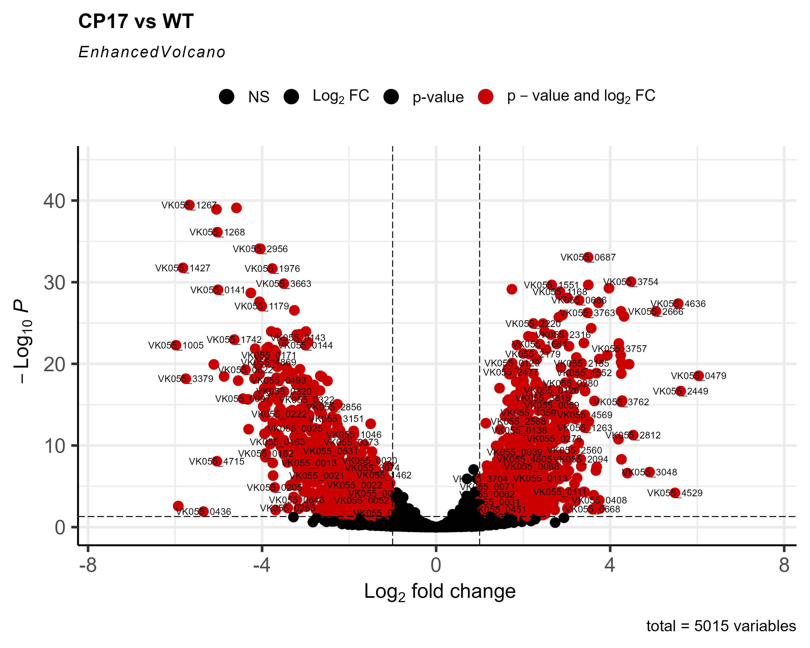
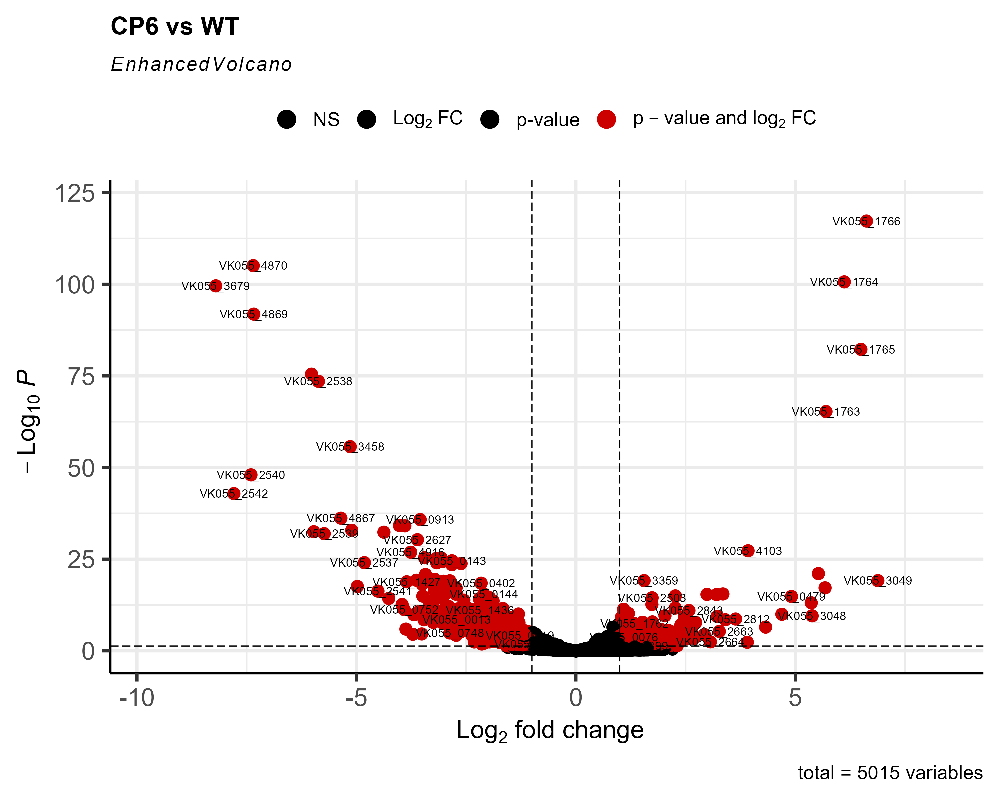
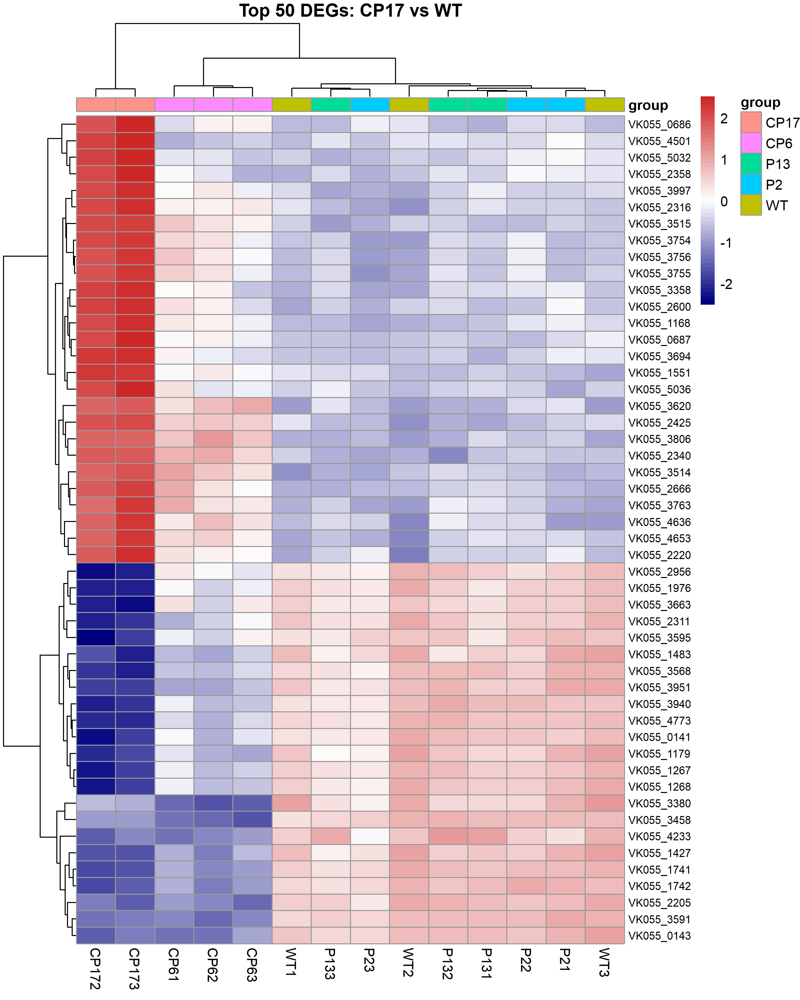

# Abstract

Antimicrobial resistance (AMR) is a global health crisis, and *Klebsiella pneumoniae* is one of the most critical pathogens. This study performed a transcriptomic analysis of *K. pneumoniae* under different stress conditions to identify genes and mechanisms associated with resistance. Using publicly available RNA-seq data (GSE237490), we performed differential expression analysis with DESeq2 across four resistant strains (CP17, CP6, P2, P13) compared to wild-type (WT). Our results revealed that the dual stress (CP6) induced the most dramatic transcriptomic changes, including upregulation of galactose metabolism genes (*galE*, *galT*, *galK*, *galM*) involved in capsule biosynthesis. Additionally, efflux pump genes (e.g., *VK055_0479*) were consistently upregulated across resistant strains, highlighting a common resistance mechanism.

# 1. Introduction

*Klebsiella pneumoniae* is a Gram-negative pathogen responsible for severe hospital-acquired infections. The emergence of multidrug-resistant (MDR) strains has made treatment increasingly difficult, and the World Health Organization has classified *K. pneumoniae* as a priority pathogen. Understanding the molecular mechanisms of resistance is essential for developing novel therapeutic strategies. In this study, we analyzed publicly available RNA-seq data from *K. pneumoniae* strains subjected to different stress conditions to identify key genes and pathways involved in resistance.

# 2. Materials and Methods

## 2.1 Data Source

Publicly available RNA-seq data were obtained from the Gene Expression Omnibus (GEO) under accession number **GSE237490**. The dataset included 15 samples from five groups: wild-type (WT), CP17, CP6, P2, and P13 (three replicates each).

## 2.2 Data Processing

Raw count data were processed using **DESeq2** in R. Genes with low expression (counts < 10 in fewer than 3 samples) were filtered out. Normalization was performed using the median-of-ratios method, and differential expression analysis was conducted for each resistant group compared to WT.

## 2.3 Visualization

Principal Component Analysis (PCA) was performed using variance-stabilizing transformation (VST). Volcano plots were generated using **EnhancedVolcano**, and heatmaps were created with **pheatmap**.

## 2.4 Functional Annotation

Key differentially expressed genes (DEGs) were annotated using the **KEGG** database to identify their biological functions and pathways.

# 3. Results

## 3.1 PCA and Quality Control

The PCA plot (Figure 1) showed clear separation between the WT group and the dual-stress groups (CP17, CP6), indicating substantial transcriptomic changes under dual stress. In contrast, phage-only resistant strains (P2, P13) clustered closer to WT.


## 3.2 Differential Expression Analysis

```{r}

```


```{r}

```

```{r}

```
```{r}
df <- data.frame(
  Gene = c("VK055_0479", "VK055_1763-1766", "VK055_4636", "VK055_2558"),
  Group = c("CP17, CP6, P13", "CP6", "CP17", "P2"),
  Function = c("Efflux pump (Bcr/CflA)", "Galactose metabolism", "Inositol monophosphatase", "Na+/H+ antiporter"),
  Interpretation = c("Antibiotic extrusion", "Capsule biosynthesis", "Oxidative stress response", "Ionic homeostasis")
)
knitr::kable(df, caption = "Table 1. Key DEGs and their functions.")
```

4. Discussion
Our analysis revealed that K. pneumoniae employs distinct resistance mechanisms depending on the type of stress. Under dual stress (CP6, CP17), the bacterium showed dramatic transcriptomic changes, including upregulation of galactose metabolism genes involved in capsule biosynthesis. Efflux pump genes (e.g., VK055_0479) were consistently upregulated across resistant strains, indicating a common mechanism for antibiotic extrusion. In contrast, phage-only resistant strains (P2, P13) showed minimal transcriptomic changes, suggesting that resistance to phage alone may be mediated by non-transcriptional mechanisms.

5. Limitations & Future Work
This study has limitations, including the use of a single dataset and the lack of experimental validation (e.g., qPCR). Future work should include multi-dataset meta-analysis and experimental validation of key candidate genes.

6. References
Qin K, Shi X, Yang K, et al. Phage-antibiotic synergy suppresses resistance emergence of Klebsiella pneumoniae. mBio. 2024;15(10):e0139324.

Love MI, Huber W, Anders S. Moderated estimation of fold change and dispersion for RNA-seq data with DESeq2. Genome Biology. 2014;15(12):550.

Kanehisa M, Goto S. KEGG: Kyoto Encyclopedia of Genes and Genomes. Nucleic Acids Research. 2000;28(1):27-30.
