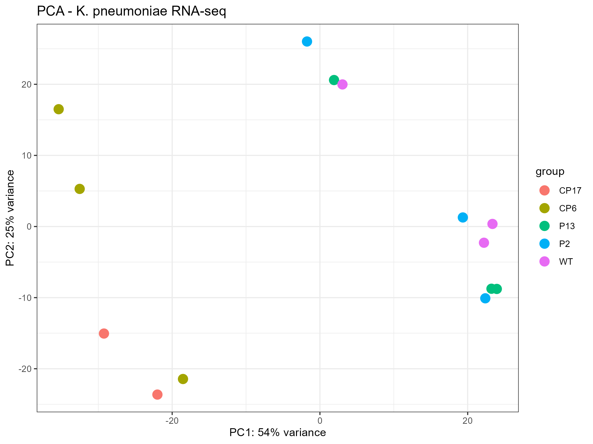
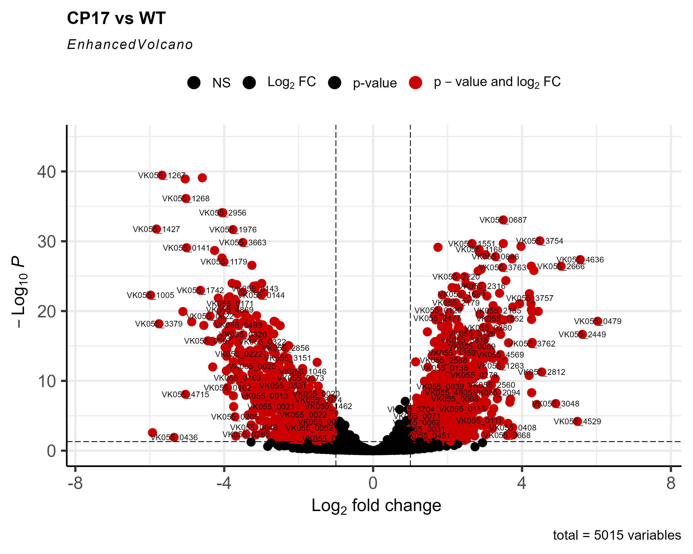
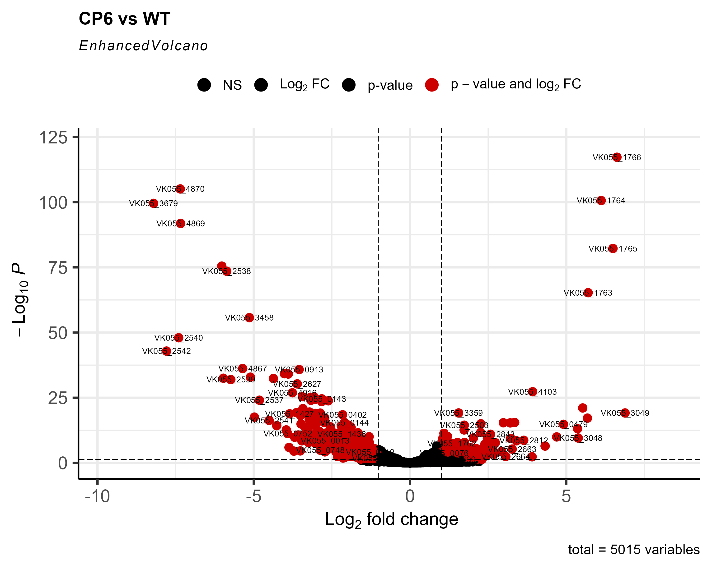
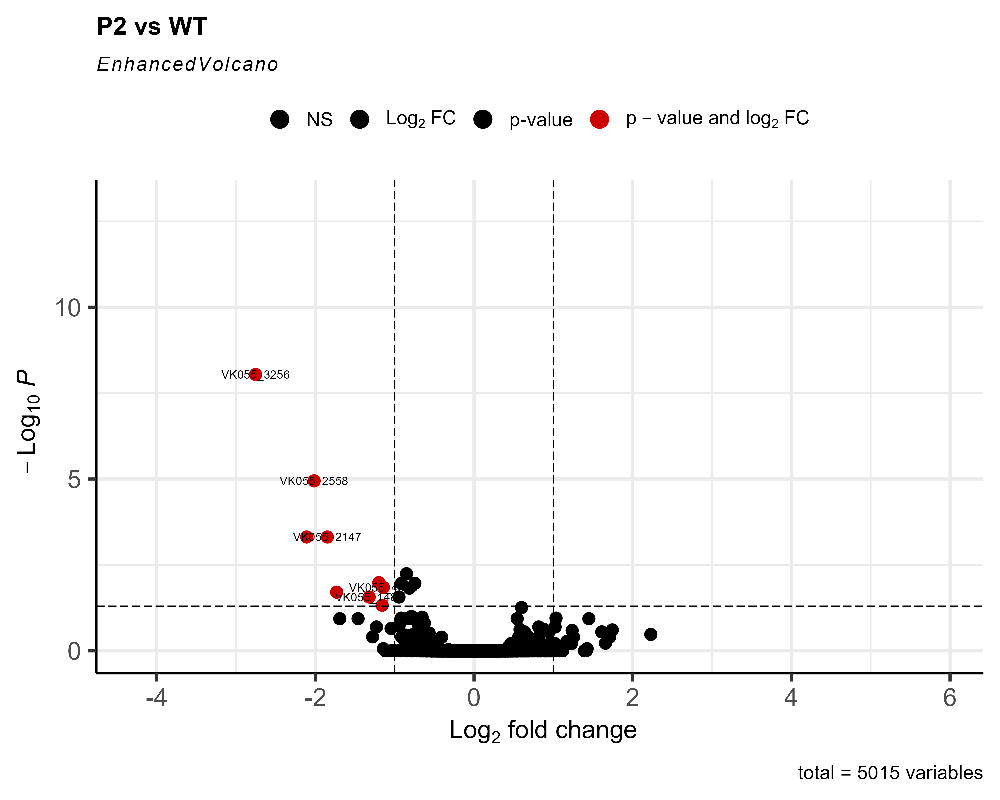
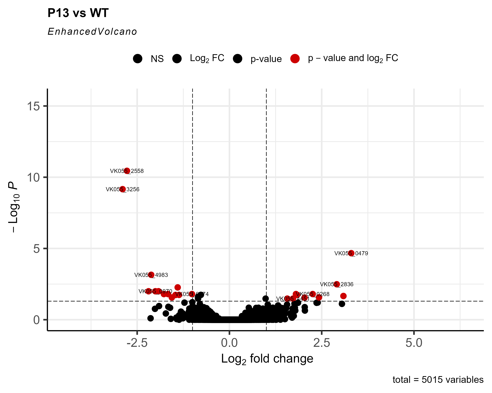
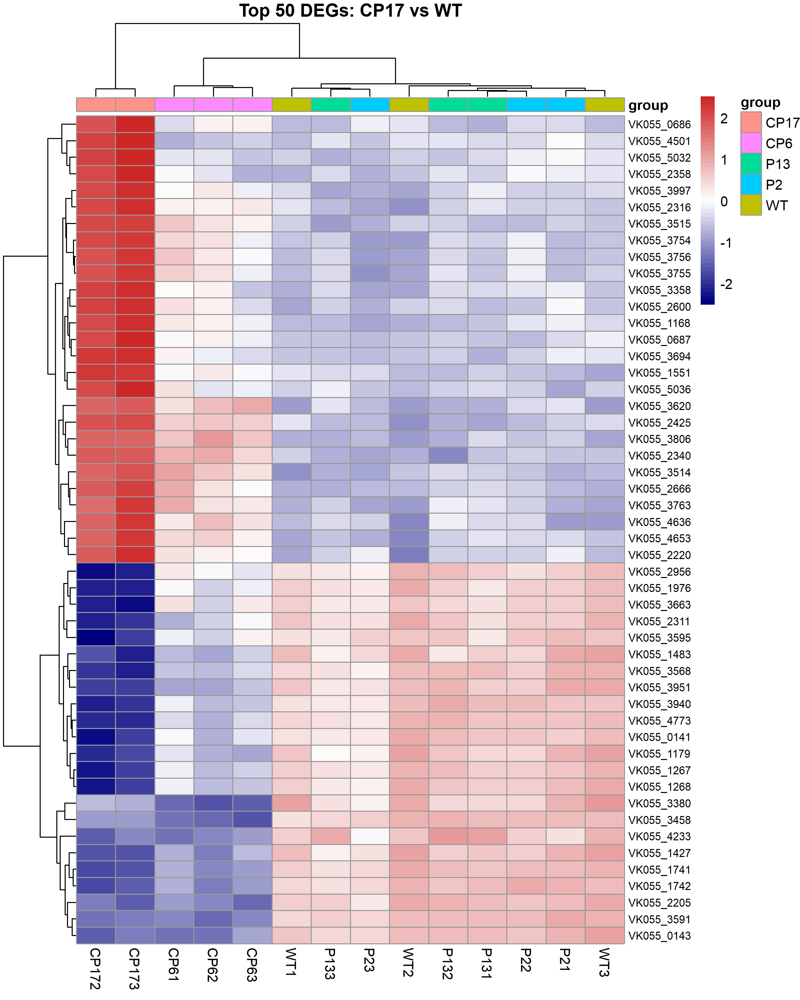

```{r setup, include=FALSE}
knitr::opts_chunk$set(echo = FALSE, warning = FALSE, message = FALSE,
                      out.width = "100%", fig.align = "center")
```

# Abstract

Antimicrobial resistance (AMR) is a global health crisis, and *Klebsiella pneumoniae* is one of the most critical pathogens. This study performed a transcriptomic analysis of *K. pneumoniae* under different stress conditions to identify genes associated with resistance. Using publicly available RNA-seq data (GSE237490), we performed differential expression analysis with DESeq2 across four resistant groups (CP17, CP6, P2, P13) compared to wild-type (WT). The dual-stress group CP17 showed the largest transcriptional response (1,832 DEGs), followed by CP6 (840 DEGs), while the phage-only groups P2 and P13 showed minimal changes (9 and 23 DEGs). CP6 was distinguished by strong upregulation of a gene cluster annotated as galactose metabolism (VK055_1763--1766; log2FC 5.7--6.6), which may be linked to capsule biosynthesis. The efflux pump gene VK055_0479 was upregulated in three of the four groups (CP17, CP6, P13), suggesting a shared resistance-associated mechanism.

# 1. Introduction

*Klebsiella pneumoniae* is a Gram-negative pathogen responsible for severe hospital-acquired infections. The emergence of multidrug-resistant (MDR) strains has made treatment increasingly difficult, and the World Health Organization has classified *K. pneumoniae* as a priority pathogen. Understanding the molecular mechanisms of resistance is essential for developing novel therapeutic strategies. In this study, we re-analyzed publicly available RNA-seq data (Qin et al., 2024) from *K. pneumoniae* strains subjected to different stress conditions to identify key genes involved in resistance.

# 2. Materials and Methods

## 2.1 Data Source

Publicly available RNA-seq data were obtained from the Gene Expression Omnibus (GEO) under accession number **GSE237490**. The metadata describe five groups: wild-type (WT), CP17, CP6, P2, and P13, with three replicates each (15 samples). <!-- TODO: CP171 is missing from the count matrix. After checking colnames(counts_raw), either fix the column slicing (and re-run everything) or keep the sentence below. -->
The count matrix contained 14 of these samples (CP17: two replicates; all other groups: three replicates).

## 2.2 Data Processing

Raw count data were analyzed using **DESeq2** in R. Genes with fewer than 10 counts in at least 3 samples were filtered out, leaving 5,015 genes. Normalization used the median-of-ratios method, and differential expression was tested for each resistant group versus WT. Genes were considered differentially expressed (DEGs) at adjusted p-value (padj) < 0.05 and |log2 fold change| > 1.

## 2.3 Visualization

Principal Component Analysis (PCA) was performed on variance-stabilizing transformed (VST) counts. Volcano plots were generated with **EnhancedVolcano**, and heatmaps of the top 50 DEGs (ranked by padj) with **pheatmap**.

## 2.4 Functional Interpretation

Gene functions were interpreted from the product annotation of the reference genome (locus tags VK055_*). No formal pathway enrichment analysis was performed.

# 3. Results

## 3.1 PCA and Quality Control

```{r pca, fig.cap="Figure 1. PCA of VST-transformed counts."}

```

<!-- TODO: look at Figure 1 and make sure this paragraph matches what you actually see. -->
The PCA (Figure 1) showed separation between WT and the dual-stress groups (CP17, CP6), indicating substantial transcriptomic changes under dual stress. The phage-only groups (P2, P13) clustered closer to WT.

## 3.2 Differential Expression Analysis

The number of DEGs differed markedly between groups (Table 1). CP17 had the largest response, followed by CP6, whereas P2 and P13 changed very little.

```{r deg-summary}
deg <- data.frame(
  Comparison = c("CP17 vs WT", "CP6 vs WT", "P2 vs WT", "P13 vs WT"),
  Up = c(1212, 617, 1, 19),
  Down = c(1113, 829, 15, 19),
  DEGs = c(1832, 840, 9, 23)
)
names(deg) <- c("Comparison", "Up (padj<0.1)", "Down (padj<0.1)",
                "DEGs (padj<0.05, |log2FC|>1)")
knitr::kable(deg, caption = "Number of differentially expressed genes per comparison.")
```

```{r volcano-cp17, fig.cap="Figure 2. Volcano plot, CP17 vs WT."}

```

```{r volcano-cp6, fig.cap="Figure 3. Volcano plot, CP6 vs WT."}

```

```{r volcano-p2, fig.cap="Figure 4. Volcano plot, P2 vs WT."}

```

```{r volcano-p13, fig.cap="Figure 5. Volcano plot, P13 vs WT."}

```

```{r heatmap, fig.cap="Figure 6. Heatmap of the top 50 DEGs, CP17 vs WT."}

```

## 3.3 Key Genes

The efflux pump gene VK055_0479 was the most strongly upregulated gene in CP17 and was also upregulated in CP6 and P13, but not in P2. In CP6, the most significant genes were the cluster VK055_1763--1766 (padj as low as $10^{-118}$). In P2, the top gene VK055_2558 was *down*regulated (Table 2). Note that P2 had many low-count genes (35%), so its results have lower statistical power.

```{r key-genes}
key <- data.frame(
  Gene = c("VK055_0479", "VK055_0479", "VK055_0479",
           "VK055_1763--1766", "VK055_4636", "VK055_2558"),
  Group = c("CP17", "CP6", "P13", "CP6", "CP17", "P2"),
  log2FC = c("6.03", "4.91", "3.30", "5.70 to 6.62", "5.56", "-2.02"),
  Function = c("Efflux pump (Bcr/CflA)", "Efflux pump (Bcr/CflA)",
               "Efflux pump (Bcr/CflA)", "Galactose metabolism",
               "Inositol monophosphatase", "Na+/H+ antiporter")
)
knitr::kable(key, caption = "Key DEGs and their annotated functions.")
```

# 4. Discussion

Our analysis suggests that the transcriptional response of *K. pneumoniae* depends on the type of stress. The dual-stress groups (CP17, CP6) showed large transcriptomic changes (1,832 and 840 DEGs), whereas the phage-only groups (P2, P13) showed minimal changes (9 and 23 DEGs). CP6 showed strong upregulation of a gene cluster annotated as galactose metabolism, which may be related to capsule biosynthesis; this link should be confirmed against the genome annotation. The efflux pump gene VK055_0479 was upregulated in CP17, CP6 and P13, pointing to a possible shared mechanism of antibiotic extrusion. The small transcriptional change in P2 and P13 raises the hypothesis that phage resistance in these strains may rely on non-transcriptional mechanisms (e.g., mutations), which this dataset cannot test.

# 5. Limitations and Future Work

This study used a single dataset with few replicates (CP17 had only two in the count matrix) and had no experimental validation (e.g., qPCR). Functional interpretation relied on gene annotation without enrichment analysis. Future work should include pathway enrichment (e.g., KEGG with clusterProfiler), multi-dataset meta-analysis, and experimental validation of key candidate genes.

# 6. References

Qin K, Shi X, Yang K, et al. Phage-antibiotic synergy suppresses resistance emergence of *Klebsiella pneumoniae*. mBio. 2024;15(10):e0139324.

Love MI, Huber W, Anders S. Moderated estimation of fold change and dispersion for RNA-seq data with DESeq2. Genome Biology. 2014;15(12):550.
