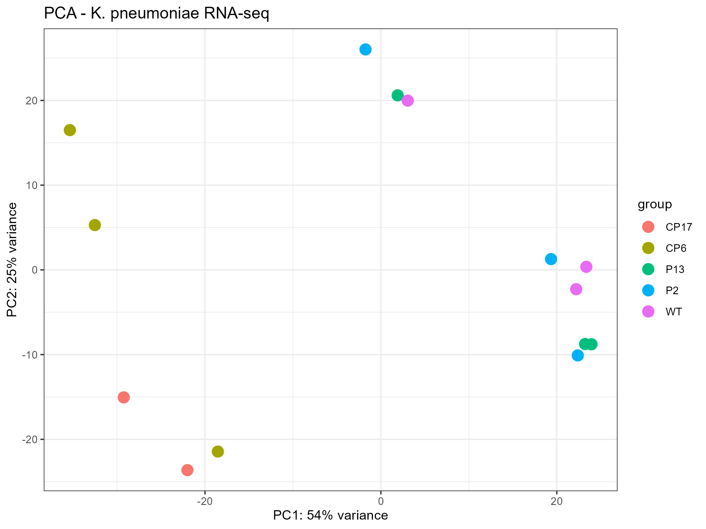
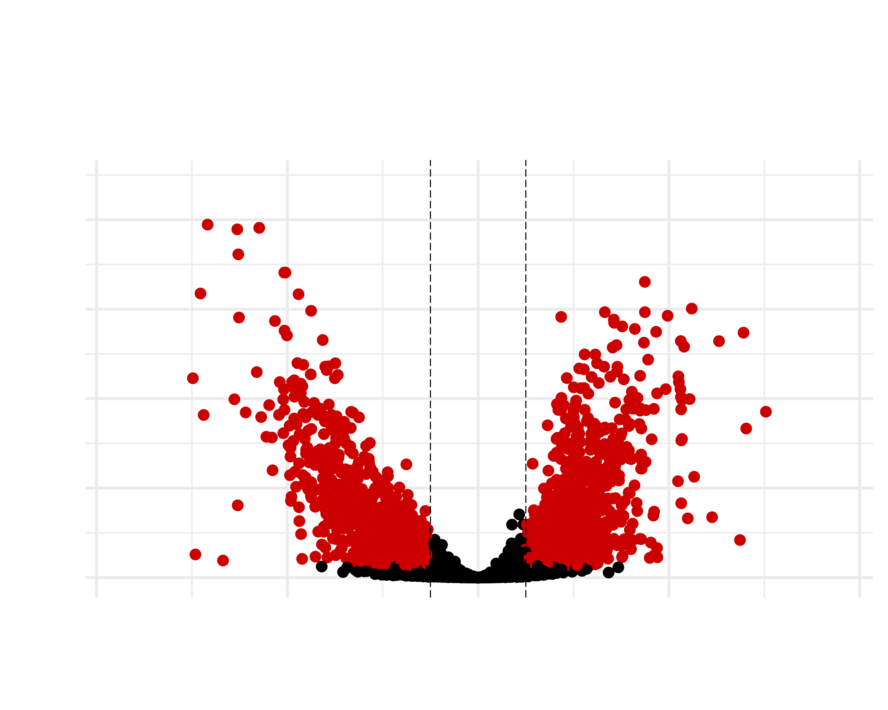
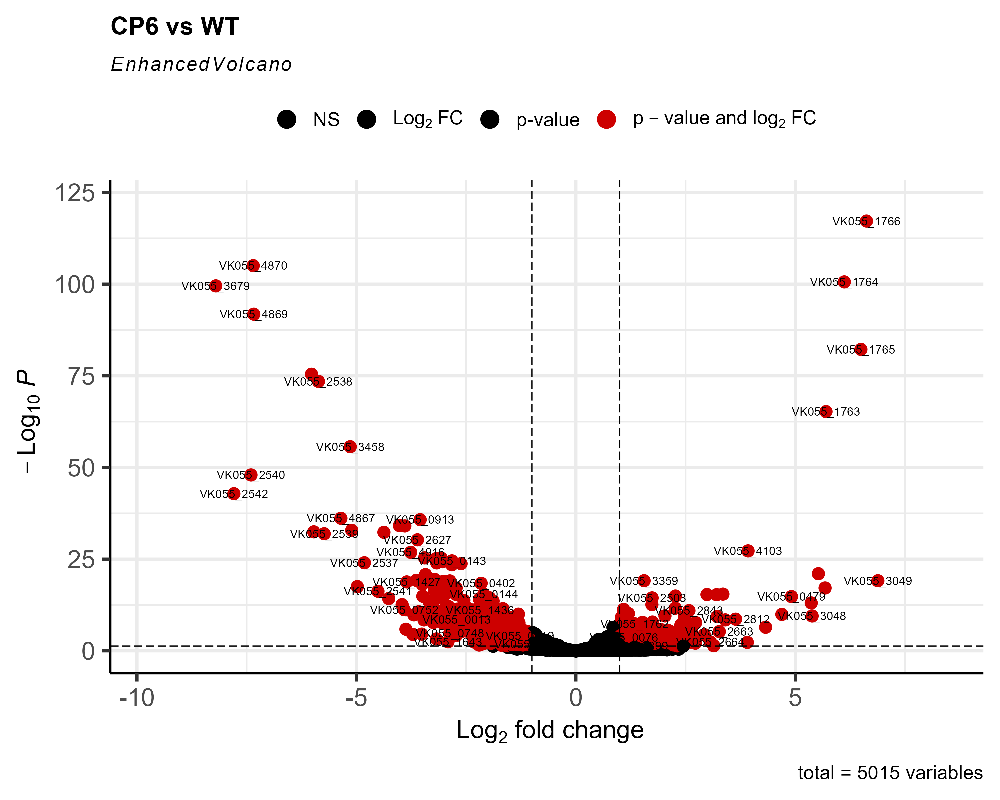
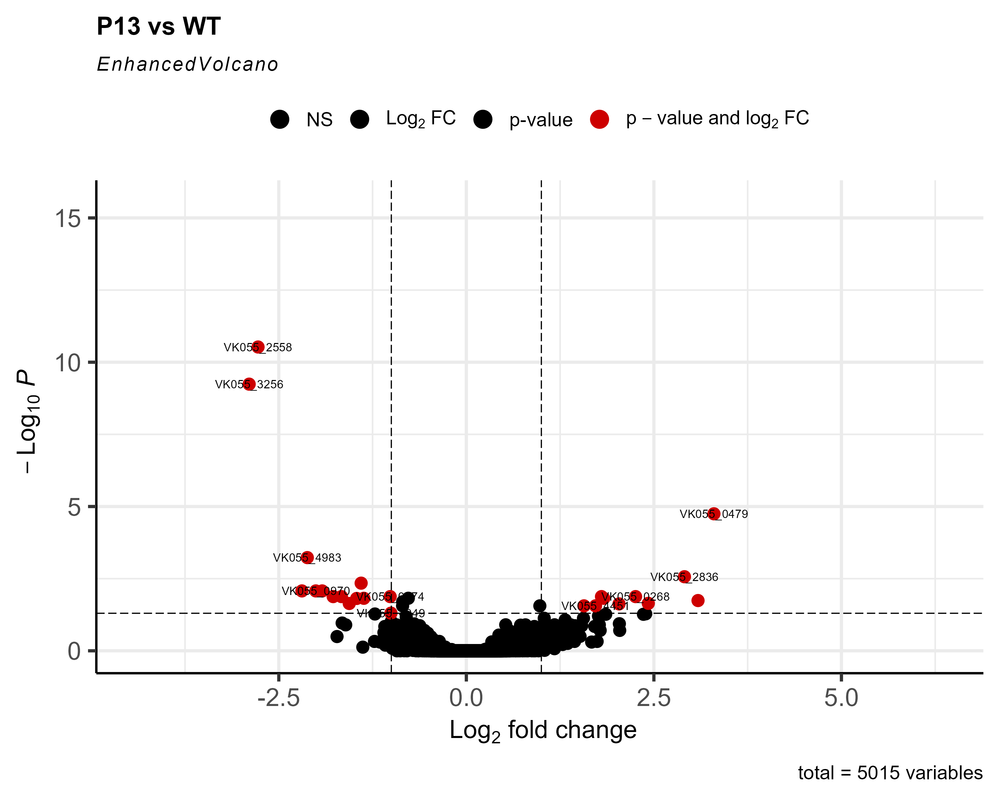
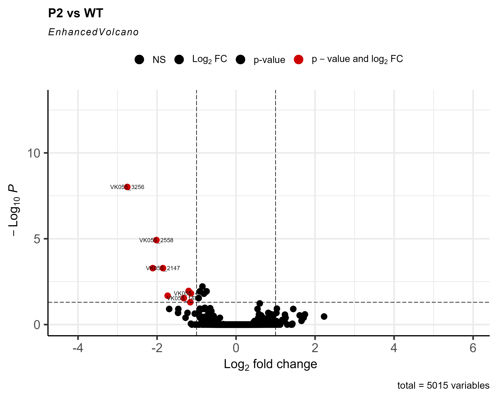
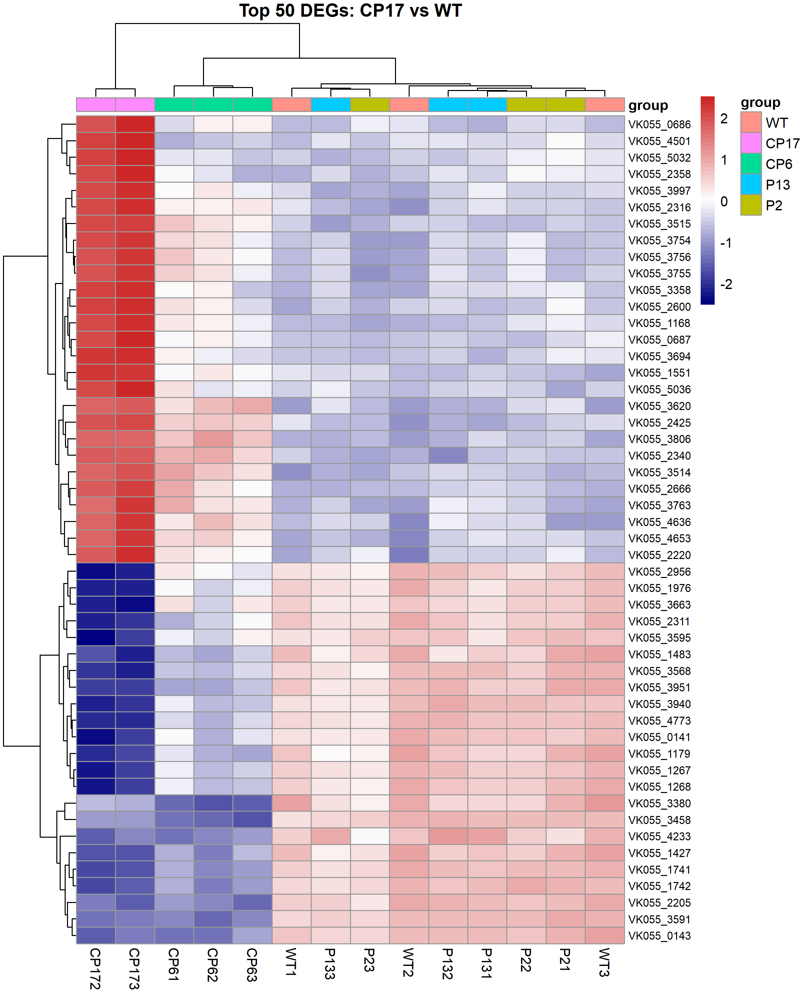

```{r setup, include=FALSE}
knitr::opts_chunk$set(
  echo = FALSE,
  warning = FALSE,
  message = FALSE,
  out.width = "100%",
  fig.align = "center"
)
```

# Abstract

Antimicrobial resistance (AMR) is a major global health challenge, and *Klebsiella pneumoniae* is a critical opportunistic pathogen. In this study, we re-analyzed publicly available RNA-seq count data (**GSE237490**) across four stress/resistant groups (`CP17`, `CP6`, `P13`, and `P2`) compared against wild-type (`WT`) using **DESeq2**. Across 14 matched samples (`CP17`: n = 2; `WT`, `CP6`, `P13`, `P2`: n = 3 each) and 5,015 filtered genes, dual-stress comparisons showed broader transcriptional shifts (`CP17` vs `WT`: 1,832 DEGs; `CP6` vs `WT`: 851 DEGs) than single-phage comparisons (`P13` vs `WT`: 24 DEGs; `P2` vs `WT`: 9 DEGs) at `padj < 0.05` and `|log2FC| > 1`. Upregulation of `VK055_0479` was observed in `CP17`, `CP6`, and `P13`, while the `VK055_1763--1766` cluster showed prominent upregulation in `CP6` (`log2FC` ~ 5.70 to 6.62). Because `CP17` includes two replicates and one outlier was flagged per contrast, these results should be interpreted cautiously prior to functional validation.

# 1. Introduction

*Klebsiella pneumoniae* is a Gram-negative bacterium frequently implicated in healthcare-associated infections and multidrug-resistant (MDR) phenotypes. Examining transcriptional responses under antibiotic and phage stress helps generate testable hypotheses regarding stress adaptation and resistance mechanisms. Here, we re-analyzed RNA-seq count data from **GSE237490** in R.

# 2. Materials and Methods

## 2.1 Data Source and Sample Matching

Raw count data and sample metadata were obtained from GEO under accession **GSE237490**. After intersecting sample identifiers between the count matrix and metadata, **14 matched samples** were retained (`WT`: 3, `CP6`: 3, `P13`: 3, `P2`: 3, and `CP17`: 2).

## 2.2 Differential Expression Analysis

Differential expression was performed using **DESeq2** with `WT` set as the reference group (`design = ~ group`). Low-count genes were filtered (`rowSums(counts(dds) >= 10) >= 3`), retaining **5,015 genes**. Differentially expressed genes (DEGs) were defined using a unified threshold of **`padj < 0.05` and `|log2FoldChange| > 1`**.

## 2.3 Visualization and Functional Scope

Variance-stabilizing transformation (`vst`) was used for Principal Component Analysis (PCA) and heatmap visualization (top 50 DEGs meeting `padj < 0.05` and `|log2FC| > 1` in `CP17` vs `WT`). Volcano plots were generated with **EnhancedVolcano**. Functional interpretation in this version relies on reference genome product annotations (`VK055_*` locus tags) rather than formal GO/KEGG pathway enrichment analysis.

# 3. Results

## 3.1 PCA and Quality Control

```{r pca, fig.cap="Figure 1. PCA of VST-transformed counts across matched samples."}

```

## 3.2 Differential Expression Summary

```{r deg-summary}
deg <- data.frame(
  Comparison = c("CP17 vs WT", "CP6 vs WT", "P13 vs WT", "P2 vs WT"),
  Upregulated = c(948, 295, 10, 0),
  Downregulated = c(884, 556, 14, 9),
  Total_DEGs = c(1832, 851, 24, 9)
)
knitr::kable(
  deg,
  caption = "Summary of DEGs (padj < 0.05 and |log2FoldChange| > 1) per comparison."
)
```

```{r volcano-cp17, fig.cap="Figure 2. Volcano plot for CP17 vs WT."}

```

```{r volcano-cp6, fig.cap="Figure 3. Volcano plot for CP6 vs WT."}

```

```{r volcano-p13, fig.cap="Figure 4. Volcano plot for P13 vs WT."}

```

```{r volcano-p2, fig.cap="Figure 5. Volcano plot for P2 vs WT."}

```

```{r heatmap, fig.cap="Figure 6. Heatmap of top 50 significant DEGs (CP17 vs WT, VST Z-scores)."}

```

## 3.3 Key Genes

```{r key-genes}
key <- data.frame(
  Comparison = c("CP17 vs WT", "CP6 vs WT", "P13 vs WT",
                 "CP6 vs WT", "CP17 vs WT", "P2 vs WT"),
  Gene = c("VK055_0479", "VK055_0479", "VK055_0479",
           "VK055_1763--1766", "VK055_4636", "VK055_2558"),
  log2FC = c("6.03", "4.91", "3.30",
             "5.70 to 6.62", "5.56", "-2.02"),
  padj = c("2.89e-19", "1.66e-15", "1.79e-05",
           "6.20e-118 (min)", "4.22e-28", "1.20e-05"),
  Annotation = c("Efflux pump (Bcr/CflA)", "Efflux pump (Bcr/CflA)", "Efflux pump (Bcr/CflA)",
                 "Galactose metabolism cluster", "Inositol monophosphatase", "Na+/H+ antiporter")
)
knitr::kable(key, caption = "Selected significant DEGs across comparisons.")
```

# 4. Discussion and Limitations

The magnitude of detected transcriptional changes differs substantially across comparisons, with larger DEG counts in `CP17` (1,832) and `CP6` (851) compared with `P13` (24) and `P2` (9) under `padj < 0.05` and `|log2FoldChange| > 1`. `VK055_0479` is significantly upregulated in `CP17`, `CP6`, and `P13`, while `VK055_1763--1766` shows strong upregulation in `CP6`.

Important limitations must be noted:

* `CP17` contains two replicates rather than three, and `DESeq2` flagged one outlier per comparison, which can reduce statistical precision and stability.
* Transcriptional changes alone do not confirm functional antimicrobial resistance or phenotypic changes.
* Functional links (such as `VK055_1763--1766` with capsule biosynthesis or `VK055_0479` function) represent preliminary hypotheses based on genome annotations and require further pathway/enrichment and experimental validation.